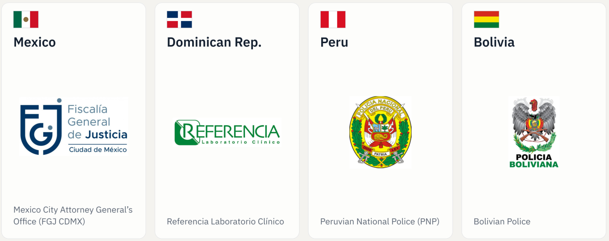

# Track record and validation

GENis was born in 2014 from a concrete requirement: the country's public prosecution offices asked for a common tool to manage forensic genetic profiles. The request came through the Council of Prosecutors, Attorneys, Defenders and General Advisors of the Argentine Republic and the Federal Criminal Policy Council. Since then the system has gone through a continuous life cycle of development, validation, deployment, support and evolution, with the backing of scientific bodies, universities and judicial institutions.

## Project phases

| Phase | Period | Type |
|---|---|---|
| Ideation and requirements | 2014 | Construction |
| Development | 2014–2017, 2018–2019 and 2021–2024 | Construction |
| Validation | 2017–2018, 2019, 2020, 2021–2022 and 2023 | Validation and approval |
| Approval | 2017 | Validation and approval |
| Deployment | 2015 (first instance) and continuously since 2017 | Operation |
| Integration | Since 2021 | Operation |

## Technical validation

The Fundación Sadosky took special care over the testing and validation stages, and followed the ISFG software validation recommendations (see [Standards and best practices](estandares_y_mejores_practicas.md#software-validation-recommendations)). It brought in national universities to address distinct aspects of the tool:

| Period | Institution | Contribution |
|---|---|---|
| 2017–2018 | UBA, LAFHIS | Statistical assessment and match verification |
| 2018–2019 | UNLP, LINTI | Information security |
| 2020–2022 | CONICET, IDEGEN | Population study |
| 2020–2022 | National University of Comahue | Usability evaluation |
| 2020–2022 | National University of Tucumán | Functional analysis |
| 2020–2022 | National University of Quilmes | Code publication and community management |

## Scientific publications

The system and its calculation models have been submitted to review by the international scientific community, in line with the [transparency](declaracion_de_principios.md#transparency) principle.

| Year | Topic | Publication |
|---|---|---|
| 2020 | Forensic module | *Forensic Science International: Reports* 2, 100132. "GENis, an open-source multi-tier forensic DNA information system" |
| 2022 | MPI module | *Forensic Science International: Genetics Supplement Series* 8, 131–132. "Bayesian networks for DNA-based kinship analysis: functionality and validation of the GENis missing person identification module" |
| 2024 | Information theory | *Forensic Science International: Genetics* 70, 103025. "The Missing Person problem through the lens of information theory" |
| 2024 | Judicial cooperation | *Communications of the ACM*, Latin America special section. "GENis: Open Source Forensic Genetics Software for Judicial Cooperation" ([DOI 10.1145/3653291](https://doi.org/10.1145/3653291)) |

## International recognition

The ENFSI guideline *Guideline for DNA Database Management: Review and Recommendations* (DNA-GDL-004, edition 001, 5 October 2023) cites GENis as the open-source system developed by Argentina to run forensic DNA databases at local, regional and national levels.

## Deployment

The number of Argentine jurisdictions with a GENis instance grew from 1 in 2015 to 3 in 2017, 13 in 2019 and 20 in 2023, out of a total of 24 (23 provinces and the Autonomous City of Buenos Aires). User institutions include the Supreme Court of Justice of the Nation, the Ministry of Justice, the National Genetic Data Bank and provincial and federal police forces.

Outside the country, the system is deployed at institutions in Mexico (Mexico City Attorney General's Office), the Dominican Republic (Referencia Laboratorio Clínico), Peru (National Police) and Bolivia (Bolivian Police).

The growth of the deployment and its extension to other countries underlie [instance interconnection](../busqueda_de_perfiles/interconexion_de_instancias.md).
