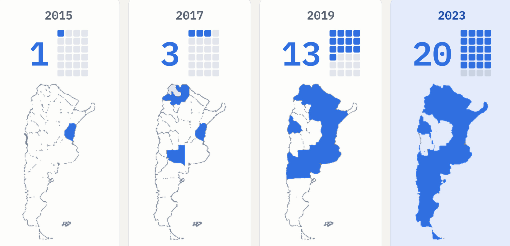
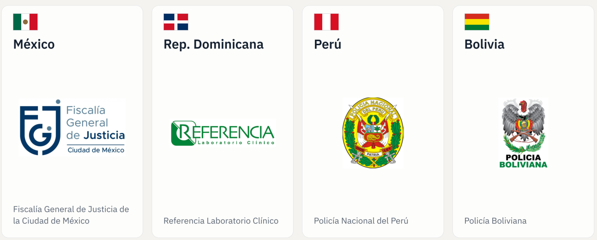

# Trayectoria y validación

GENis nació en 2014 de un requerimiento concreto: los ministerios públicos del país pidieron una herramienta común para gestionar perfiles genéticos forenses. El pedido llegó a través del Consejo de Procuradores, Fiscales, Defensores y Asesores Generales de la República Argentina y del Consejo Federal de Política Criminal. Desde entonces el sistema recorrió un ciclo de vida continuo de desarrollo, validación, despliegue, soporte y evolución, con el acompañamiento de organismos científicos, universidades e instituciones judiciales.

## Fases del proyecto

| Fase | Período | Tipo |
|---|---|---|
| Ideación y requerimiento | 2014 | Construcción |
| Desarrollo | 2014–2017, 2018–2019 y 2021–2024 | Construcción |
| Validación | 2017–2018, 2019, 2020, 2021–2022 y 2023 | Validación y aprobación |
| Aprobación | 2017 | Validación y aprobación |
| Despliegue | 2015 (primera instancia) y desde 2017 de forma continua | Operación |
| Integración | Desde 2021 | Operación |

## Validación técnica

La Fundación Sadosky puso especial cuidado en las instancias de prueba y validación, y siguió las recomendaciones de validación de la ISFG (ver [Estándares y mejores prácticas](estandares_y_mejores_practicas.md#recomendaciones-de-validacion-de-software)). Convocó a universidades nacionales para abordar aspectos diferenciados de la herramienta:

| Período | Institución | Aporte |
|---|---|---|
| 2017–2018 | UBA, LAFHIS | Valoración estadística y verificación del matching |
| 2018–2019 | UNLP, LINTI | Seguridad informática |
| 2020–2022 | CONICET, IDEGEN | Estudio poblacional |
| 2020–2022 | Universidad Nacional del Comahue | Evaluación de usabilidad |
| 2020–2022 | Universidad Nacional de Tucumán | Análisis funcional |
| 2020–2022 | Universidad Nacional de Quilmes | Publicación del código y gestión de comunidad |

## Publicaciones científicas

El sistema y sus modelos de cálculo fueron sometidos a revisión de la comunidad científica internacional, en línea con el principio de [transparencia](declaracion_de_principios.md#transparencia).

| Año | Tema | Publicación |
|---|---|---|
| 2020 | Módulo Forense | *Forensic Science International: Reports* 2, 100132. "GENis, an open-source multi-tier forensic DNA information system" |
| 2022 | Módulo MPI | *Forensic Science International: Genetics Supplement Series* 8, 131–132. "Bayesian networks for DNA-based kinship analysis: functionality and validation of the GENis missing person identification module" |
| 2024 | Teoría de la información | *Forensic Science International: Genetics* 70, 103025. "The Missing Person problem through the lens of information theory" |
| 2024 | Cooperación judicial | *Communications of the ACM*, sección especial de América Latina. "GENis: Open Source Forensic Genetics Software for Judicial Cooperation" ([DOI 10.1145/3653291](https://doi.org/10.1145/3653291)) |

## Reconocimiento internacional

La guía de ENFSI *Guideline for DNA Database Management: Review and Recommendations* (DNA-GDL-004, edición 001, 5 de octubre de 2023) cita a GENis como el sistema de código abierto desarrollado por la Argentina para gestionar bases de datos de ADN forense en los niveles local, regional y nacional.

## Despliegue

La cantidad de jurisdicciones argentinas con una instancia de GENis pasó de 1 en 2015 a 3 en 2017, 13 en 2019 y 20 en 2023, sobre un total de 24 (23 provincias y la Ciudad Autónoma de Buenos Aires). Entre las instituciones usuarias se cuentan la Corte Suprema de Justicia de la Nación, el Ministerio de Justicia, el Banco Nacional de Datos Genéticos y fuerzas policiales provinciales y federales.

Fuera del país, el sistema se despliega en instituciones de México (Fiscalía General de Justicia de la Ciudad de México), República Dominicana (Referencia Laboratorio Clínico), Perú (Policía Nacional) y Bolivia (Policía Boliviana).

El crecimiento del despliegue y la extensión a otros países son la base de la [interconexión de instancias](../busqueda_de_perfiles/interconexion_de_instancias.md).
