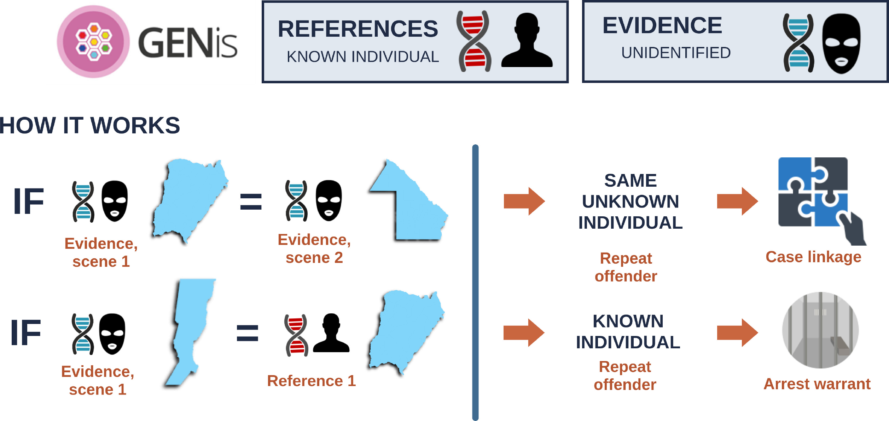
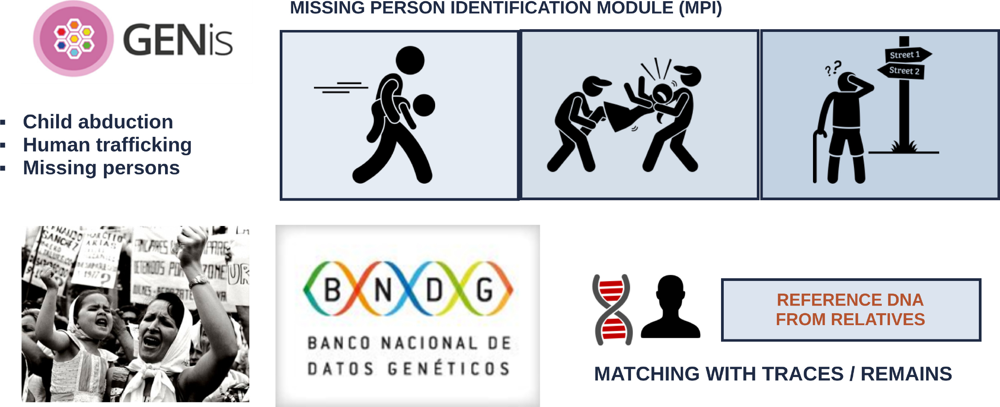

# Fields of application

In every use of GENis two kinds of profiles are compared: those of **known origin** (reference samples) and those of **unknown origin** (evidence, remains or unidentified persons). Which kind a profile belongs to is determined by its [category](../genis/genetica_forense.md#profile-categories-and-classification).

| Field | Known origin | Unknown origin | Question it answers |
|---|---|---|---|
| [**Forensic analysis**](#forensic-analysis) | References from identified subjects (suspects, convicts) | Evidence found at crime scenes | Were two events committed by the same person? Is that person already known? |
| [**Missing persons search (MPI)**](#missing-persons-search) | Relatives of the sought person and their personal belongings | Traces, remains, unidentified deceased persons and people seeking their biological identity | Does any of these profiles belong to the relative sought in this family tree? |
| [**Disaster victim identification (DVI)**](#disaster-victim-identification) | Relatives of the victims | Remains and unidentified victims of the event | Which family does each recovered remain belong to? |
| [**Missing minors search**](#missing-minors-search) | To be defined | To be defined | To be defined |

The underlying difference lies in the type of comparison. In forensic analysis the comparison is **direct**: one profile against another. In MPI and DVI the sought person has no profile of their own, so the comparison is **kinship-based**: a family tree (pedigree) against the unidentified profiles. Both mechanisms are explained in [Forensic Genetics Concepts](../genis/genetica_forense.md).

## Forensic analysis

In forensic analysis, GENis makes it possible to compare the genetic profiles loaded by different institutions in order to answer two investigative questions: whether two events were committed by the same person, and whether that person is already known.

### Profile types

It works with **references**, samples from identified subjects, and **evidence**, biological material found at a scene whose contributor is N.N. (unknown). See [Profiles of known and unknown origin](#fields-of-application).

### How it works

GENis compares each new profile against the existing ones, even if they were provided by different institutions or countries. Depending on which type of profile matches which, the result has a different investigative meaning.

#### Evidence against evidence

When the evidence from the scene of one event matches the evidence from the scene of another event, it is the **same unknown individual**, who is also a **repeat offender**. The operational consequence is the **unification of investigations**: two cases that were running separately, even in different countries, can be handled as a single line of investigation.

!!! example "Example"
    A profile found at a scene in Brazil matches the profile of evidence from a scene in Colombia. Both events are linked to the same perpetrator, still unidentified.

#### Evidence against reference

When the evidence from a scene matches a reference profile, the contributor is no longer unknown: it is a **known individual** and also a **repeat offender**. The operational consequence is that the competent authority can issue an **arrest warrant**.

!!! example "Example"
    A profile found at a scene in Costa Rica matches the reference of a subject loaded in Panama. The match identifies the perpetrator of the event.

#### Summary

| Match | Conclusion | Investigative result |
|---|---|---|
| Evidence with evidence | Same unknown individual, repeat offender | Unification of investigations |
| Evidence with reference | Known individual, repeat offender | Arrest warrant |

!!! note "Scope of a match"
    A match in GENis is an indication that guides the investigation and must be confirmed and assessed according to each institution's protocols. The criteria used to compare profiles and the associated statistical assessment are explained in [Forensic Genetics Concepts](../genis/genetica_forense.md#direct-comparison-str-matching-engine) and in [Profile matching](../busqueda_de_perfiles/coincidencia_de_perfiles.md).

### Cross references

- Profile registration: [Profile registration](../busqueda_de_perfiles/alta_de_perfiles.md)
- Match review: [Match manager and forensic calculations](../busqueda_de_perfiles/gestor_de_coincidencias_y_calculos_forense.md)
- Exchange between institutions: [Instance interconnection](../busqueda_de_perfiles/interconexion_de_instancias.md)

## Missing persons search

Missing persons search (MPI, *Missing Person Identification*) is intended for identifying people whose whereabouts or identity are unknown. It is mainly applied in three situations:

- Child abduction.
- Human trafficking.
- Missing persons.

### How it works

MPI is based on **genetic kinship**. Instead of comparing the profile of the person being sought, which is usually unavailable, it works with the profiles of their relatives:

1. **Registration of relatives' DNA.** Profiles of biological relatives of the sought person are loaded, act as references and are organized into a family tree (pedigree) within a case.
2. **Matching against traces and remains.** When the pedigree is activated, GENis compares it with the profiles of traces, remains or other samples of persons not yet identified. The search is **open**: every new profile entered into the database under an MPI category is compared against all active pedigrees.

When the comparison detects kinship compatibility, a match is generated that must be reviewed and validated through a scenario to guide identification. As an optional prior filter, the search can use mitochondrial DNA from the maternal line (mitochondrial screening).

### Relatives' DNA registries

An example of a relatives' DNA registry is the **Banco Nacional de Datos Genéticos (BNDG)**, the Argentine institution that safeguards the samples of family groups searching for missing persons or for appropriated children. The foundation of the GENis kinship engine was validated with real pedigrees from that bank (see [Forensic Genetics Concepts](../genis/genetica_forense.md#kinship-comparison-bayesian-networks)).

### Further reading

- Operation of cases, pedigrees, matches and scenarios: [Missing persons search](../busqueda_de_perfiles/busqueda_de_personas.md).
- Fixed MPI categories (Ante Mortem and Post Mortem): [Categories](../administracion/categorias.md#category-definition).
- Bayesian-network kinship engine: [Forensic Genetics Concepts](../genis/genetica_forense.md#kinship-comparison-bayesian-networks).
- Differences with disaster victim identification: [DVI](#differences-with-mpi).

## Disaster victim identification

Disaster victim identification (DVI) is intended for identifying the victims of a mass-casualty event, comparing the recovered remains with the profiles of the relatives of the sought persons.

It shares its foundation with [missing persons search (MPI)](#missing-persons-search): the sought person has no profile of their own, so the comparison is **kinship-based**, using family trees (pedigrees). The difference is that in DVI the search universe is **closed**: the remains and the families belong to the same event and are compared only with each other.

### How it works

1. **Case creation.** Each event is managed as a DVI case, which gathers two groups of profiles:
    - **Reference profiles (Ante Mortem):** relatives of the sought persons.
    - **Post mortem NN profiles:** unidentified biological remains, unidentified deceased persons, deceased persons whose identity is to be analyzed, and personal belongings found.
2. **Grouping of remains.** When several profiles correspond to the same individual (for example, different fragments), they are consolidated into a single grouping profile, the most complete one. This way each individual takes part in the search only once, redundant matches are avoided, and the comparison uses the largest number of available alleles.
3. **Pedigrees.** A pedigree is built for each family with its reference profiles.
4. **Search.** When a pedigree is activated, GENis compares it against the active post mortem profiles of the same case.
5. **Review.** Matches are reviewed in the case's match manager and validated through a scenario.

### Differences with MPI

| Aspect | MPI | DVI |
|---|---|---|
| Search universe | Open: every new profile in an MPI category is compared against all active pedigrees | Closed: the search is launched when a pedigree is activated and covers only the case's profiles |
| Post mortem profiles | Matched from the general database | Associated with the case, in a dedicated tab |
| Grouping of remains | No | Yes |
| Mitochondrial screening | Optional, as a prior filter | Not used: with incomplete, degraded or partial profiles, using it as an exclusion filter could discard valid associations |

### Further reading

- Operation of DVI cases, grouping of remains and matches: [Missing persons search](../busqueda_de_perfiles/busqueda_de_personas.md#remains-grouping-collapsing).
- Fixed DVI categories: [Categories](../administracion/categorias.md#category-definition).
- Bayesian-network kinship engine: [Forensic Genetics Concepts](../genis/genetica_forense.md#kinship-comparison-bayesian-networks).

## Missing minors search

## Exchange between instances

So that comparison goes beyond a single institution, GENis instances connect with each other through a federated architecture: each node keeps ownership and administration of its profiles and shares only what is needed to detect matches. The harmonization conditions and the submission, review and notification circuit are described in [Instance interconnection](../busqueda_de_perfiles/interconexion_de_instancias.md).
