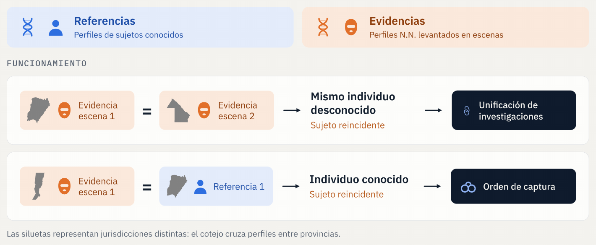
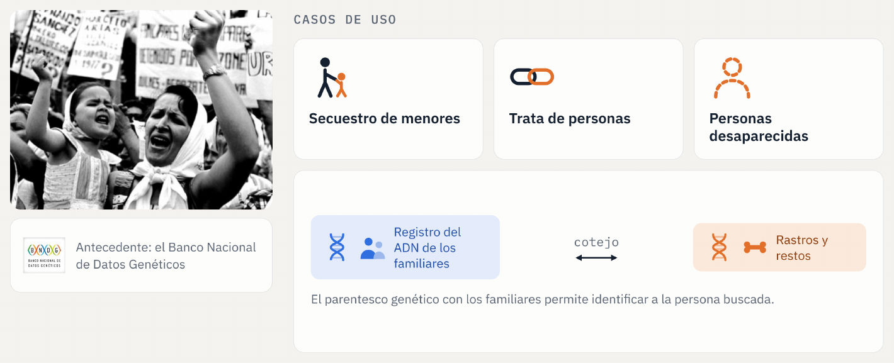

# Ámbitos de aplicación

En todos los usos de GENis se contrastan dos clases de perfiles: los de **origen conocido** (muestras de referencia, también llamadas indubitadas) y los de **origen desconocido** (evidencias, restos o personas no identificadas). A qué clase pertenece cada perfil lo determina su [categoría](../genis/genetica_forense.md#categorias-y-clasificacion-de-perfiles).

| Ámbito | Origen conocido | Origen desconocido | Pregunta que responde |
|---|---|---|---|
| [**Análisis forense**](#analisis-forense) | Referencias de sujetos identificados (sospechosos, condenados) | Evidencias halladas en escenas de crimen | ¿Dos hechos fueron cometidos por la misma persona? ¿Esa persona ya es conocida? |
| [**Búsqueda de personas desaparecidas (MPI)**](#busqueda-de-personas-desaparecidas) | Familiares de la persona buscada y sus elementos personales | Rastros, restos, personas fallecidas no identificadas y personas que buscan conocer su identidad biológica | ¿Alguno de estos perfiles corresponde al pariente buscado en este árbol familiar? |
| [**Identificación de víctimas de desastres (DVI)**](#identificacion-de-victimas-de-desastres) | Familiares de las víctimas | Restos y víctimas no identificadas del evento | ¿A qué familia pertenece cada resto recuperado? |
| [**Búsqueda de menores desaparecidos**](#busqueda-de-menores-desaparecidos) | Por definir | Por definir | Por definir |

La diferencia de fondo está en el tipo de comparación. En el análisis forense la comparación es **directa**: un perfil contra otro perfil. En MPI y DVI la persona buscada no tiene un perfil propio, por lo que la comparación es **por parentesco**: un árbol familiar (pedigrí) contra los perfiles no identificados. Ambos mecanismos se explican en [Conceptos de Genética Forense](../genis/genetica_forense.md).

## Análisis forense

En el análisis forense, GENis permite contrastar los perfiles genéticos cargados por distintas instituciones para responder dos preguntas investigativas: si dos hechos fueron cometidos por la misma persona y si esa persona ya es conocida.

### Tipos de perfiles

Se trabaja con **referencias**, muestras de sujetos identificados, y **evidencias**, material biológico hallado en una escena cuyo aportante es N.N. (desconocido). Ver [Perfiles de origen conocido y desconocido](#ambitos-de-aplicacion).

### Funcionamiento

GENis compara cada perfil nuevo contra los ya existentes, incluso si fueron aportados por instituciones o países distintos. Según qué tipo de perfil coincide con cuál, el resultado tiene un significado investigativo diferente.

#### Evidencia contra evidencia

Cuando la evidencia de la escena de un hecho coincide con la evidencia de la escena de otro hecho, se trata del **mismo individuo desconocido**, que además es un **sujeto reincidente**. La consecuencia operativa es la **unificación de investigaciones**: dos causas que corrían por separado, incluso en países distintos, pueden tratarse como una sola línea de investigación.

!!! example "Ejemplo"
    Un perfil hallado en una escena en Brasil coincide con el perfil de una evidencia de una escena en Colombia. Ambos hechos se vinculan con el mismo autor, todavía sin identificar.

#### Evidencia contra referencia

Cuando la evidencia de una escena coincide con el perfil de una referencia, el aportante deja de ser desconocido: se trata de un **individuo conocido** y también un **sujeto reincidente**. La consecuencia operativa es que la autoridad competente puede disponer una **orden de captura**.

!!! example "Ejemplo"
    Un perfil hallado en una escena en Costa Rica coincide con la referencia de un sujeto cargada en Panamá. La coincidencia identifica al autor del hecho.

#### Resumen

| Coincidencia | Conclusión | Resultado investigativo |
|---|---|---|
| Evidencia con evidencia | Mismo individuo desconocido, sujeto reincidente | Unificación de investigaciones |
| Evidencia con referencia | Individuo conocido, sujeto reincidente | Orden de captura |

!!! note "Alcance de la coincidencia"
    Una coincidencia en GENis es un indicio que orienta la investigación y debe ser confirmada y valorada conforme a los protocolos de cada institución. El criterio con que se comparan los perfiles y la valoración estadística asociada se explican en [Conceptos de Genética Forense](../genis/genetica_forense.md#comparacion-directa-motor-de-coincidencias-str) y en [Coincidencia de perfiles](../busqueda_de_perfiles/coincidencia_de_perfiles.md).

### Referencias cruzadas

- Registro de perfiles: [Alta de perfiles](../busqueda_de_perfiles/alta_de_perfiles.md)
- Revisión de coincidencias: [Gestor de coincidencias y cálculos forense](../busqueda_de_perfiles/gestor_de_coincidencias_y_calculos_forense.md)
- Intercambio entre instituciones: [Interconexión de instancias](../busqueda_de_perfiles/interconexion_de_instancias.md)

## Búsqueda de personas desaparecidas

La búsqueda de personas (MPI, *Missing Person Identification*) está destinada a la identificación de personas cuyo paradero o identidad se desconoce. Se aplica principalmente en tres situaciones:

- Secuestros de menores.
- Trata de personas.
- Personas desaparecidas.

### Cómo funciona

MPI se basa en el **parentesco genético**. En lugar de comparar el perfil de la persona buscada, que habitualmente no está disponible, se trabaja con el de sus familiares:

1. **Registro del ADN de los familiares.** Se cargan los perfiles de familiares biológicos de la persona buscada, que actúan como referencia, y se organizan en un árbol familiar (pedigrí) dentro de un caso.
2. **Cotejo con rastros y restos.** Al activar el pedigrí, GENis lo compara con los perfiles de rastros, restos u otras muestras de personas aún no identificadas. La búsqueda es **abierta**: cada perfil nuevo que ingresa a la base en una categoría de MPI se compara contra todos los pedigríes activos.

Cuando el cotejo detecta compatibilidad de parentesco, se genera una coincidencia que debe ser revisada y validada mediante un escenario para orientar la identificación. Como filtro previo opcional, la búsqueda puede usar el ADN mitocondrial de la línea materna (*screening* mitocondrial).

### Registros de ADN de familiares

Un ejemplo de registro de ADN de familiares es el **Banco Nacional de Datos Genéticos (BNDG)**, institución argentina que resguarda las muestras de grupos familiares que buscan a personas desaparecidas o a niños apropiados. El fundamento del motor de parentesco de GENis fue validado con pedigríes reales de ese banco (ver [Conceptos de Genética Forense](../genis/genetica_forense.md#comparacion-por-parentesco-redes-bayesianas)).

### Profundización

- Operación de casos, pedigríes, coincidencias y escenarios: [Búsqueda de personas](../busqueda_de_perfiles/busqueda_de_personas.md).
- Categorías fijas de MPI (Ante Mortem y Post Mortem): [Categorías](../administracion/categorias.md#definicion-de-categorias).
- Motor de parentesco por redes bayesianas: [Conceptos de Genética Forense](../genis/genetica_forense.md#comparacion-por-parentesco-redes-bayesianas).
- Diferencias con la identificación de víctimas de desastres: [DVI](#diferencias-con-mpi).

## Identificación de víctimas de desastres

La identificación de víctimas de desastres (DVI, *Disaster Victim Identification*) está destinada a identificar a las víctimas de un evento con múltiples víctimas, comparando los restos recuperados con los perfiles de los familiares de las personas buscadas.

Comparte con la [búsqueda de personas (MPI)](#busqueda-de-personas-desaparecidas) el fundamento: la persona buscada no tiene un perfil propio, por lo que la comparación se hace **por parentesco**, mediante árboles familiares (pedigríes). La diferencia es que en DVI el universo de búsqueda es **cerrado**: los restos y las familias pertenecen a un mismo evento y se comparan solo entre sí.

### Cómo funciona

1. **Creación del caso.** Cada evento se gestiona como un caso de tipo DVI, que reúne dos grupos de perfiles:
    - **Perfiles de referencia (Ante Mortem):** familiares de las personas buscadas.
    - **Perfiles NN post mortem:** restos biológicos no identificados, personas fallecidas no identificadas, personas fallecidas cuya identidad quiere analizarse y elementos personales hallados.
2. **Agrupación de restos.** Cuando varios perfiles corresponden a un mismo individuo (por ejemplo, distintos fragmentos), se consolidan en un único perfil agrupador, el más completo. Así cada individuo participa una sola vez en la búsqueda, se evitan coincidencias redundantes y se compara con la mayor cantidad de alelos disponibles.
3. **Pedigríes.** Para cada familia se arma un pedigrí con sus perfiles de referencia.
4. **Búsqueda.** Al activar un pedigrí, GENis lo compara contra los perfiles post mortem activos del mismo caso.
5. **Revisión.** Las coincidencias se revisan en el gestor de coincidencias del caso y se validan mediante un escenario.

### Diferencias con MPI

| Aspecto | MPI | DVI |
|---|---|---|
| Universo de búsqueda | Abierto: cada perfil nuevo de una categoría de MPI se compara contra todos los pedigríes activos | Cerrado: la búsqueda se lanza al activar un pedigrí y abarca solo los perfiles del caso |
| Perfiles post mortem | Se cotejan desde la base general | Se asocian al caso, en una solapa propia |
| Agrupación de restos | No | Sí |
| *Screening* mitocondrial | Opcional, como filtro previo | No se utiliza: con perfiles incompletos, degradados o parciales, usarlo como filtro excluyente podría descartar asociaciones válidas |

### Profundización

- Operación de casos DVI, agrupación de restos y coincidencias: [Búsqueda de personas](../busqueda_de_perfiles/busqueda_de_personas.md#agrupaciones-de-restos-collapsing).
- Categorías fijas de DVI: [Categorías](../administracion/categorias.md#definicion-de-categorias).
- Motor de parentesco por redes bayesianas: [Conceptos de Genética Forense](../genis/genetica_forense.md#comparacion-por-parentesco-redes-bayesianas).

## Búsqueda de menores desaparecidos

## Intercambio entre instancias

Para que la comparación trascienda a una única institución, las instancias de GENis se conectan entre sí mediante una arquitectura federada: cada nodo conserva la propiedad y administración de sus perfiles y comparte solo lo necesario para detectar coincidencias. Las condiciones de armonización y el circuito de envío, revisión y notificación se describen en [Interconexión de instancias](../busqueda_de_perfiles/interconexion_de_instancias.md).
